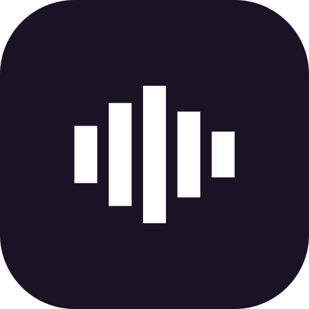

<div align="center">



# Specty

See what your audio files really contain.

An open-source audio quality analyzer for Android. It shows the spectrogram, loudness and dynamics, and codec facts, and it checks whether a "lossless" file started life as a lossy one.

[](https://github.com/RoTatsuLabs/Specty/actions/workflows/quality.yml)
[](LICENSE)


</div>

## Overview

A file labelled FLAC or ALAC may have been transcoded from an MP3 or upsampled from a lower sample rate. Specty decodes the file on your device, measures it, and reports what it found, including how sure it is.

Everything runs locally. There is no account, the app declares no internet permission, and nothing is uploaded.

## Features

- **File and codec info:** codec, container, sample rate, bit depth, bitrate, channels, duration and size
- **Levels and dynamics:** peak, true peak, RMS, integrated loudness (LUFS, ITU-R BS.1770-4), dynamic range, clipping and effective bit depth, per channel
- **Spectrogram:** a combined view and one tab per channel, with adjustable window size, window function, palette and level range. A full-screen viewer supports zoom, pan and a readout of frequency, time and level.
- **Authenticity check:** finds a lossy or upsampled origin in the spectrum and gives a verdict with a confidence score, the cutoff frequency and where in the track it appears
- **Compare:** two files side by side, with a difference image, overlaid spectra and a metrics table
- **Library:** built from folders you pick, with search, sorting, grouping and filtering by verdict. Scan it all in the background.
- **Saved results:** finished analyses are stored on the device, so a checked file opens instantly
- **Playback:** play a file with a moving cursor on the spectrogram
- **Export:** save the spectrogram as a PNG with axes, legend and title
- **Dolby:** Atmos in E-AC-3 files is recognised. AC-4 is decoded with the device's own codec when it has one.
- **Languages:** English, Indonesian and Simplified Chinese

## How the analysis works

```
file -> FFprobe -> decode to 32-bit float PCM
                        |
        +---------------+----------------+
        v               v                v
  level measurement  spectrogram    authenticity spectrum
  peak, RMS, LUFS,   (your chosen   (fixed 4096-point
  true peak,         window size)    Hann transform)
  bit depth                               |
                                          v
                                  verdict and confidence
```

The verdict uses its own fixed transform, so changing the spectrogram settings never changes it. Results are cached with an algorithm version, so a new release re-analyses files instead of showing old verdicts. The analysis code in `audio/` has no Android dependencies and is covered by plain JVM unit tests.

| Verdict | Meaning |
| --- | --- |
| Genuine | Content reaches the top of the spectrum with no cutoff or roll-off |
| Lossy source | A hard cutoff typical of an MP3 or AAC low-pass |
| Possible lossy source | A sharp cutoff near 20 kHz in a 44.1 or 48 kHz file. A high-bitrate lossy source or some masters can do this. |
| Upsampled | Content stops near 22 kHz in a file with a higher sample rate |
| Band limited | The spectrum fades out early, for example from a mastering filter |
| Lossy format | The codec is lossy by definition, so the spectrum is not judged |
| Dolby Atmos | Object audio in an E-AC-3 stream, not judged for lossy origin |
| Inconclusive | Too little evidence for a verdict |

Specty reports measured evidence only. The Nyquist frequency is never reported as a cutoff, and the thresholds were tuned on synthetic spectra. A sharp cutoff near 16 kHz is strong evidence of a lossy origin. One near 20 kHz is only suggestive.

## Using the library

Specty has no storage permission. Open the library menu, choose Library folders, and pick your music folders with the system picker. Subfolders are included and you can exclude any of them. You can also open a single file, or open an audio file from another app.

## Build from source

You need JDK 17, Android SDK 36 and Gradle 8.14 or newer.

```sh
gradle :app:testDebugUnitTest   # unit tests
gradle :app:assembleDebug       # debug APK in app/build/outputs/apk/debug/
```

| | |
| --- | --- |
| Package | `com.rotatsulabs.specty` |
| Min and target SDK | 26 (Android 8) and 36 |
| ABIs | `arm64-v8a`, `x86_64` |
| Decoding | FFmpeg through [`ffmpeg-kit-min`](https://github.com/ffmpegkit-maintained/ffmpeg), plus the device's `MediaCodec` for formats FFmpeg cannot decode |

CI runs lint, the unit tests and a debug build on every push to `main` and on pull requests.

## Privacy

Specty reads audio only to analyse it, and only inside the folders you choose. It asks for the notification permission only to show progress during a library scan. Analyses and cover thumbnails stay on the device, and you can clear them in Settings.

## Contributing

Issues and pull requests are welcome. Run `gradle :app:testDebugUnitTest` before you send a change. New analysis logic needs a unit test with a synthetic signal. Commit messages follow [Conventional Commits](https://www.conventionalcommits.org/). Coding agents should read [AGENTS.md](AGENTS.md).

## License

Specty is free software released under the [GNU General Public License v3.0](LICENSE). The About page in the app lists every bundled library with its licence and the full texts. FFmpeg reaches Specty through the ffmpeg-kit fork, which is LGPL v3.0.
