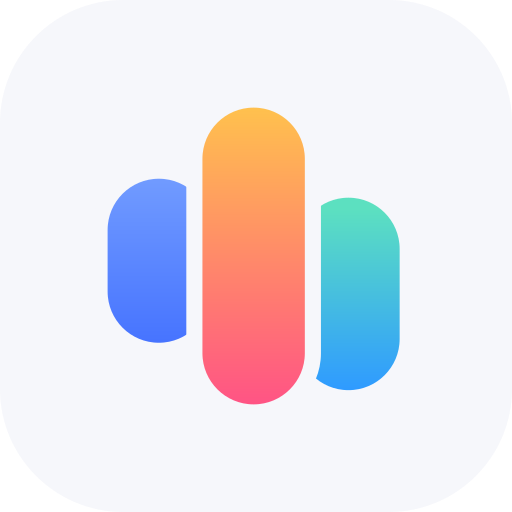

<div align="center">



# Specty

**See what is actually inside your audio files.**

An open-source audio analyzer for Android. It draws the spectrogram, measures loudness and dynamics, and tells you whether a "lossless" file was ever lossless.

[](https://github.com/RoTatsuLabs/Specty/releases/latest)
[](https://github.com/RoTatsuLabs/Specty/actions/workflows/quality.yml)
[](LICENSE)


[Download](https://github.com/RoTatsuLabs/Specty/releases/latest) · [Report a problem](https://github.com/RoTatsuLabs/Specty/issues)

</div>

<br>

## What it does

- Open a file and the verdict comes first: genuine, lossy source, upsampled or band limited, along with the cutoff frequency and how confident Specty is.
- The spectrogram opens full screen with zoom, pan and a readout of frequency, time and level. You can export it as a PNG.
- Measurements cover peak, true peak, loudness (LUFS), dynamic range, clipping and effective bit depth, per channel.
- The library scans your music folders in the background. Filter by verdict, compare two tracks or look for duplicates.

Analysis happens on your device and no file leaves it. The app is in English, Indonesian and Simplified Chinese.

## Install

Download an APK from the [latest release](https://github.com/RoTatsuLabs/Specty/releases/latest) and open it on a device running Android 8.0 or newer.

| File | For |
| --- | --- |
| `arm64-v8a` | Most phones and tablets |
| `armeabi-v7a` | Older 32-bit phones |
| `x86_64` | Emulators and x86 devices |
| `universal` | Any device, larger download |

Install a newer APK over the old one to update.

## Build

You need JDK 17 and the Android SDK. The exact versions are in the build files.

```sh
gradle testDebugUnitTest      # unit tests
gradle :app:assembleDebug     # debug APK
```

The analysis code lives in `:core:audio`, plain Kotlin with no Android dependencies, so its tests run on the JVM. The app is Jetpack Compose with Material 3 Expressive. Issues and pull requests are welcome.

## License

Specty is released under the [GNU General Public License v3.0](LICENSE). The About page lists every bundled library with its licence.

Audio is decoded with FFmpeg through [FFmpegKitNext](https://github.com/arthenica/ffmpeg-kit-next) (LGPL v3.0). Some of the Hi-Res evidence checks are Kotlin ports of code from [Mornye](https://github.com/mornyeapp/Mornye) (LGPL v3.0), used with credit.

<div align="center">
<sub>Made by RoTatsuLabs</sub>
</div>
